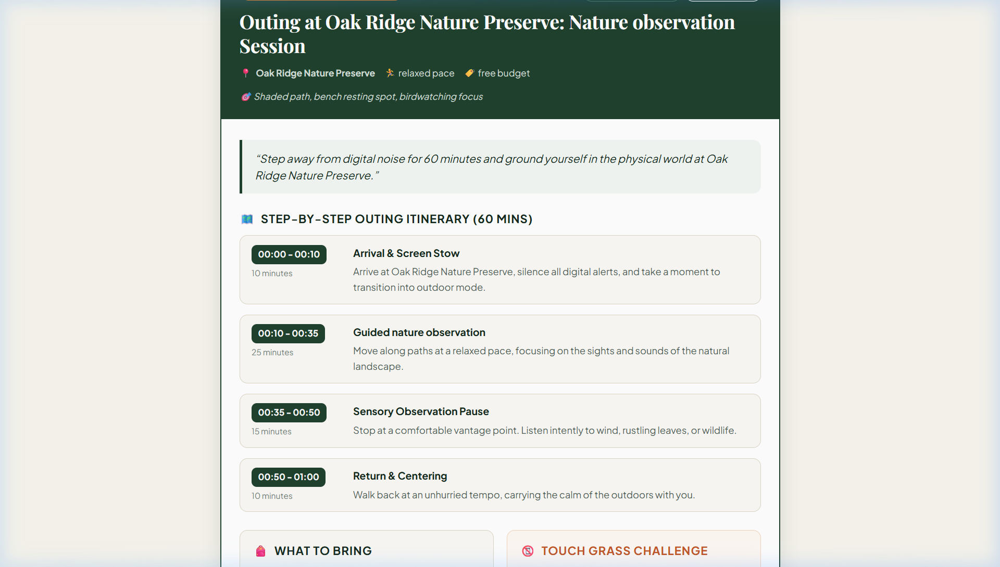

# Fieldcard 🌿

**Make a plan. Step outside. Leave the scroll behind.**

Fieldcard is an AI-powered outdoor outing planner built for the **Hacktoberfest Open-Source AI Challenge — Week 1: Touch Grass**.

It turns screen time and digital overwhelm into purposeful outdoor adventures. Enter a familiar park or outdoor destination, choose your available time and activity style, and Fieldcard generates a structured outing plan with a timed itinerary, packing checklist, screen-free sensory challenge, and closing reflection.

**🌐 Live Demo:** [Try Fieldcard](https://fieldcard-touch-grass.vercel.app/)  
**💻 Source Code:** [View on GitHub](https://github.com/PAWANBHOWATE04/fieldcard-touch-grass)



---

## 🎯 The Problem

Modern devices and algorithmic feeds compete for our attention. Endless scrolling can contribute to mental fatigue and disconnect us from our physical surroundings.

Even when people want to spend time outdoors, deciding what to do, how long to spend, and what to bring can create unnecessary friction.

## 💡 The Solution

Fieldcard makes it easier to turn the intention of going outside into a practical plan.

- **Time-bounded itineraries:** Choose 30, 60, 90, or 120 minutes.
- **Screen-free challenges:** Try simple sensory activities that encourage you to notice your surroundings.
- **Practical packing checklist:** Get suggested essentials based on your activity and budget.
- **Closing reflection:** Finish your outing with a mindful reflection question.
- **Print-friendly field card:** Print your plan on A4 paper or save it as a PDF so you can leave your phone behind.

## ✨ Features

### 🌳 Personalized Outing Planner

- Enter a familiar park or outdoor destination.
- Choose an outing duration of 30, 60, 90, or 120 minutes.
- Select an activity: walking, nature observation, gardening or community plots, nature photography, or a quiet outdoor break.
- Choose a relaxed, moderate, or energetic pace.
- Set a free or low-cost budget.
- Add optional accessibility requirements and preferences, such as paved paths, shaded benches, or birdwatching.

### 🤖 Gemma-Powered Plan Generation

- Uses Google's Gemma model through the official `@google/genai` JavaScript SDK.
- Generates structured outing plans through a server-side API endpoint.
- Keeps the API key on the server rather than exposing it in frontend code.

### ⏱️ Duration Validation

JavaScript validates and normalizes itinerary durations so the total planned time matches the selected duration.

### 🧪 Sample Mode and Error Handling

- Provides a clearly labelled sample plan when live AI generation is unavailable.
- Preserves form values when an API request fails.
- Distinguishes sample output from live AI-generated output.

### 🖨️ Print-Friendly Design

- Uses a dedicated `@media print` stylesheet.
- Hides unnecessary web interface elements when printing.
- Produces a clean, high-contrast field card designed for printing or saving as a PDF.

### 🔒 Privacy-Conscious Design

- No user accounts or application database.
- No browser geolocation tracking.
- API keys are configured through server-side environment variables.
- Live AI requests send the information needed to generate a plan to Google's API.

---

## 🏗️ Architecture and Technology Stack

```text
fieldcard-touch-grass/
├── api/
│   ├── plan.js
│   └── _lib/
│       ├── gemmaClient.js
│       ├── planSchema.js
│       └── samplePlan.js
├── demo/
│   ├── fieldcard-demo.webp
│   └── fieldcard-preview.png
├── src/
│   ├── main.jsx
│   ├── App.jsx
│   ├── index.css
│   ├── components/
│   │   ├── Header.jsx
│   │   ├── PlanForm.jsx
│   │   ├── FieldCard.jsx
│   │   ├── SampleNotice.jsx
│   │   ├── LoadingState.jsx
│   │   └── AboutModal.jsx
│   └── utils/
│       └── api.js
├── test/
│   ├── duration.test.js
│   ├── itinerary.test.js
│   ├── malformed.test.js
│   ├── sample.test.js
│   └── api-handler.test.js
├── index.html
├── vite.config.js
├── vercel.json
└── package.json
```

**Technology stack**

- **Frontend:** React 18, Vite, JavaScript, and CSS.
- **Backend:** Vercel serverless function at `/api/plan`.
- **AI integration:** Official `@google/genai` JavaScript SDK.
- **Model:** `gemma-4-26b-a4b-it` — verify the model identifier against the deployed application.
- **Local development:** Vite development server with integrated API middleware.
- **Testing:** Node.js native test runner.
- **Deployment:** Vercel.

---

## 🔒 Security and Privacy

### API Key Security

- The API key is accessed server-side through `process.env.GEMINI_API_KEY`.
- The secret is not intentionally exposed through frontend environment variables or API responses.
- `.env` and local environment files are excluded through `.gitignore`.
- `.env.example` contains a placeholder rather than a real secret.

**Never commit or share your actual API key.**

### Hosted AI and Data Handling

- Live AI inference is performed through Google's hosted API; the model does not run locally in the browser.
- Information entered into the planner, such as the destination and activity preferences, is sent to Google's API when generating a live plan.
- Fieldcard does not intentionally persist prompts or generated plans in its own application database.
- Hosting and API providers may independently process request metadata according to their policies.
- Fieldcard asks users to enter their destination manually and does not need browser geolocation.

---

## ⚠️ Limitations and Safety

- **No real-time park information:** Fieldcard does not verify opening hours, entrance fees, closures, weather, trail conditions, or local regulations.
- **Generated suggestions may be inaccurate:** Check important details independently before following an itinerary.
- **Outdoor safety:** Check the weather and local conditions, bring suitable essentials, and follow posted rules.
- **Not medical or survival advice:** Fieldcard is designed for general outdoor recreation and mindful breaks.

---

## 🚀 Getting Started

### Prerequisites

- Node.js 18 or later.
- npm.
- A Google AI Studio API key for live AI generation. Sample mode can be used without configuring a key.

### 1. Clone the repository

```bash
git clone https://github.com/PAWANBHOWATE04/fieldcard-touch-grass.git
cd fieldcard-touch-grass
```

### 2. Install dependencies

```bash
npm install
```

### 3. Configure the API key

Create a local `.env.local` file in the project root, alongside `package.json`.

You can copy `.env.example` using PowerShell:

```powershell
Copy-Item .env.example .env.local
```

Add your API key to `.env.local`:

```env
GEMINI_API_KEY=your_api_key_here
```

Get an API key from [Google AI Studio](https://aistudio.google.com/).

Keep `.env.local` private and never commit it to GitHub. If no API key is configured, the application can use its sample-plan fallback where supported by the local development setup.

### 4. Run the application

```bash
npm run dev
```

Open [http://localhost:5173](http://localhost:5173) in your browser.

The Vite development server includes middleware for `/api/plan`, allowing the frontend and local API workflow to run together.

### 5. Run the tests

```bash
npm test
```

The project's test suite covers duration validation, itinerary normalization, malformed model output, sample-plan behavior, and API-handler behavior.

**Verification note:** The project was previously tested with 15 passing tests. Run the command again after making changes to confirm the current result.

### 6. Build for production

```bash
npm run build
```

This runs the Vite production build.

---

## ☁️ Deploying to Vercel

1. Push the project to GitHub.
2. Import the repository into [Vercel](https://vercel.com/).
3. Open your project's **Settings → Environment Variables**.
4. Add the following environment variable:

   - **Name:** `GEMINI_API_KEY`
   - **Value:** Your Google AI Studio API key

5. Deploy the project and verify live plan generation.

Vercel should deploy `/api/plan.js` as a serverless function according to the project's configuration.

---

## 🎥 Demo

**Live application:** [Open Fieldcard](https://fieldcard-touch-grass.vercel.app/)

The repository also includes an animated demo and a screenshot:

- [View the animated demo](demo/fieldcard-demo.webp)
- [View the application screenshot](demo/fieldcard-preview.png)

The demo file is an animated WebP, not an MP4. You can create an MP4 walkthrough separately if a video file is required for your submission.

---

## 🌍 Why Open Innovation Matters

Fieldcard explores how open-weight AI models can support practical, real-world activities rather than simply keeping people on a screen.

- **Accessibility:** Developers can experiment with open-weight models and build useful applications.
- **Experimentation:** Developers can evaluate model outputs and adapt the surrounding application to their needs.
- **Human-centered technology:** Fieldcard uses AI to encourage people to take intentional breaks and reconnect with their surroundings.

Open-weight models still require evaluation, and generated suggestions should be checked for accuracy and safety.

---

## 🤝 Contributing

Contributions are welcome.

1. Fork the repository.
2. Create a branch for your changes.
3. Make and test your changes.
4. Open a pull request describing your contribution.

Please do not commit API keys, credentials, or other secrets.

## 📄 License

This project is open-source under the [MIT License](LICENSE).

Copyright (c) 2026 PAWAN BHOWATE.
